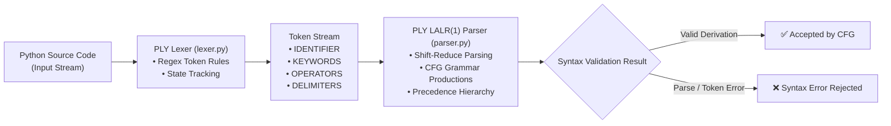
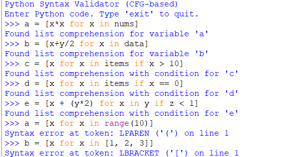
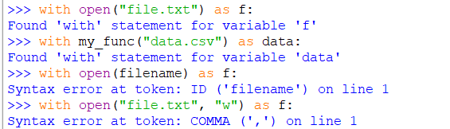
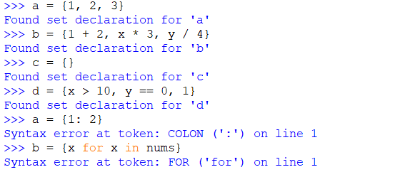

# 🐍 Python Subset Compiler & CFG Syntax Validator

[](https://github.com/Tanmayi-n14/python-subset-compiler-afll/actions/workflows/test.yml)
[](https://www.python.org/)
[](https://www.dabeaz.com/ply/)
[](#-formal-grammar-specification-ebnf)
[](https://opensource.org/licenses/MIT)

A front-end compiler pipeline and Context-Free Grammar (CFG) syntax validator for an expressive subset of the **Python 3** programming language, implemented using **Python Lex-Yacc (PLY)**. 

The compiler handles tokenization, regular expression terminal rules, and LALR(1) shift-reduce parsing across five non-trivial syntactic features of modern Python.

Developed as the **Core Coursework Project** for **Automata Theory & Formal Language Logic (UE22CS243A)** at **PES University**.

---

## 📌 Supported Python Syntactic Features

The grammar specifies LALR(1) parser rules and Lex regular expressions for:

1. **List Comprehensions**: Expressions with single/multi-variable generators, arithmetic transformations, and nested `if` guard conditions (`[x*2 for x in nums if x > 0]`).
2. **Context Managers (`with` statements)**: Single and multi-target context managers with optional alias bindings (`with open('data.txt') as f:`).
3. **Lambda Expressions**: Anonymous first-class functions with arbitrary positional argument lists and single-expression bodies (`lambda x, y: x + y`).
4. **`from ... import` Statements**: Module path navigation and multi-symbol import lists with optional dot prefixes (`from math import sin, cos`).
5. **Set Literals & Set Declarations**: Non-empty unordered collection literals with heterogeneous typed elements (`{1, 'item', 3.14}`).

---

## 🗺️ Compiler Architecture Pipeline



---

## 📐 Formal Grammar Specification (EBNF)

### 1. List Comprehension Grammar
```ebnf
list_comp       := '[' expression 'for' target_list 'in' test [comp_iter] ']'
comp_iter       := 'for' target_list 'in' test [comp_iter]
                 | 'if' test [comp_iter]
target_list     := IDENTIFIER { ',' IDENTIFIER }
```

### 2. Context Manager Grammar
```ebnf
with_stmt       := 'with' with_item { ',' with_item } ':'
with_item       := test [ 'as' target ]
target          := IDENTIFIER
```

### 3. Lambda Expression Grammar
```ebnf
lambda_expr     := 'lambda' [var_args_list] ':' expression
var_args_list   := IDENTIFIER { ',' IDENTIFIER }
```

### 4. Import Statement Grammar
```ebnf
from_import     := 'from' module_path 'import' import_targets
module_path     := { '.' } IDENTIFIER { '.' IDENTIFIER }
import_targets  := '*' | import_name { ',' import_name }
import_name     := IDENTIFIER [ 'as' IDENTIFIER ]
```

---

## 📸 Parser Execution & Verification Gallery

| 1. List Comprehensions | 2. Context Managers (`with`) |
| :---: | :---: |
|  |  |

| 3. Lambda Expressions | 4. From-Import Statements |
| :---: | :---: |
|  |  |

| 5. Set Declarations |
| :---: |
|  |

---

## 🚀 Quickstart & Execution

### 1. Prerequisites
Install `ply` (Python Lex-Yacc):
```bash
git clone https://github.com/Tanmayi-n14/python-subset-compiler-afll.git
cd python-subset-compiler-afll
pip install -r requirements.txt
```

### 2. Run Interactive REPL Validator
Launch the interactive shell where you can type Python snippets in real time:
```bash
python main.py
```
```text
Python Syntax Validator (CFG-based)
Enter Python code. Type 'exit' to quit.
>>> squares = [x**2 for x in data if x > 0]
--------------------
Valid Syntax!
--------------------
>>> with open('file.txt') without handle:
Syntax error at 'without'
```

### 3. Run Automated Test Suite
Execute the full test suite verifying positive and negative grammar derivations:
```bash
python test_suite.py
```

### 4. Run Demonstration Script
```bash
python sample_programs.py
```

---

## 📂 Repository Contents

```text
python-subset-compiler-afll/
├── .github/
│   └── workflows/
│       └── test.yml                 # Automated GitHub Actions test pipeline
├── lexer.py                         # PLY Lexer token rules and regular expressions
├── parser.py                        # PLY Yacc CFG production rules & precedence
├── main.py                          # Interactive REPL syntax validation shell
├── test_suite.py                    # Automated test harness covering 20+ test cases
├── sample_programs.py               # Live demonstration script with sample snippets
├── requirements.txt                 # Runtime dependencies (`ply>=3.11`)
├── docs/                            # PES University AFLL course specifications
└── screenshots/                     # Verified parser evaluation screenshots
```

---

## 👤 Author

* **Tanmayi Nagabhairava** ([@Tanmayi-n14](https://github.com/Tanmayi-n14)) — `PES1UG24CS493`
* Department of Computer Science & Engineering, PES University
