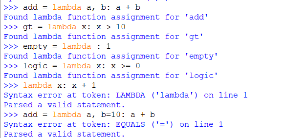
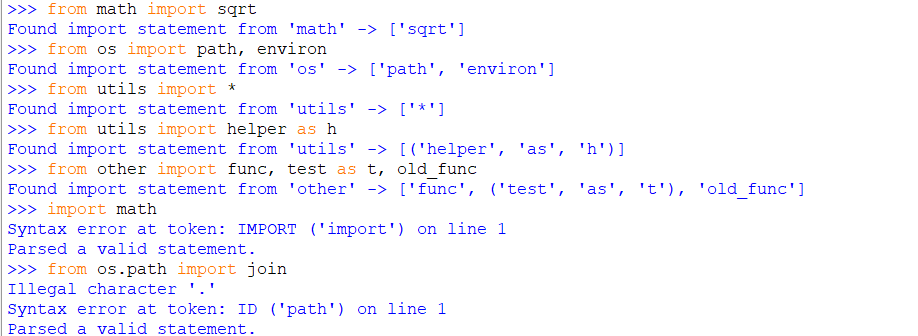

# Python Subset Syntax Validator (CFG Compiler) 🐍

A formal Context-Free Grammar (CFG) syntax validator and parser for a subset of the Python language, developed using **PLY (Python Lex-Yacc)** as part of the Automata Theory and Formal Languages (**AFLL**) coursework (`UE22CS243A`).

The project defines lexical token definitions and LALR(1) production rules for high-level Python constructs, validating syntactical correctness and reporting grammatical syntax errors with token locations.

---

## 🚀 Key Features & Language Subset

The parser implements grammar rules for 5 core Python syntax constructs alongside full arithmetic and logical expressions:

| Feature | CFG Grammar Pattern | Example |
| :--- | :--- | :--- |
| **1. List Comprehensions** | `ID = [ expr FOR ID IN ID ]` / `... IF expr ]` | `a = [x*x for x in nums]`<br>`c = [x for x in items if x > 10]` |
| **2. With Statements** | `WITH func(STRING) AS ID :` | `with open("file.txt") as f:` |
| **3. Lambda Assignments** | `ID = LAMBDA [args] : expr` | `add = lambda a, b: a + b` |
| **4. From-Import Statements** | `FROM ID IMPORT [items / aliases / *]` | `from math import sqrt`<br>`from utils import helper as h, *` |
| **5. Set Declarations** | `ID = { [expr, ...] }` | `a = {1, 2, 3}`<br>`b = {1 + 2, x * 3, y / 4}` |
| **6. Expressions & Precedence**| BODMAS + Unary (`+`, `-`) + Relational (`==`, `!=`, `<`, `>`, `<=`, `>=`) + Ternary (`a if c else b`) | `x + (y * 2) if z < 1 else 0` |

---

## 📂 Project Architecture

```
├── lexer.py               # PLY Lexer token definitions & regex patterns
├── parser.py              # PLY Yacc Context-Free Grammar (CFG) production rules
├── main.py                # Interactive REPL CLI for validating Python code
├── test_suite.py          # Automated test suite covering valid and invalid cases
├── requirements.txt       # Dependencies (ply)
├── docs/                  # Reference documents & specifications
│   ├── AFLL- List of lang.docx.pdf
│   └── UE22CS243A Python Lex-Yacc Tutorial v2-1 (1).pdf
└── screenshots/           # Verified test runs & execution output
    ├── 01_list_comprehensions.png
    ├── 02_with_statements.png
    ├── 03_lambda_functions.png
    ├── 04_from_import_statements.png
    └── 05_set_declarations.png
```

---

## 📸 Verified Test Runs

### 1. List Comprehensions


### 2. With Statements (Context Managers)


### 3. Lambda Functions & Closures


### 4. From-Import Statements & Aliasing


### 5. Set Declarations


---

## ⚙️ Installation & Usage

### 1. Prerequisites
- Python 3.8+
- PLY (Python Lex-Yacc)

### 2. Install Dependencies
```bash
pip install -r requirements.txt
```

### 3. Run the Interactive REPL
Launch the interactive validator prompt:
```bash
python main.py
```
```text
Python Syntax Validator (CFG-based)
Enter Python code. Type 'exit' to quit.
>>> a = [x * 2 for x in items if x > 5]
Found list comprehension with condition for 'a'
--------------------
Valid Syntax!
--------------------
>>>
```

### 4. Run Automated Test Suite
```bash
python test_suite.py
```

---

## 📖 Formal Grammar Specification (CFG)

```ebnf
statement       := list_comp_stmt
                 | with_stmt
                 | lambda_assign
                 | from_import_stmt
                 | set_decl
                 | expression
                 | ε

list_comp_stmt  := ID '=' '[' expression 'for' ID 'in' ID ']'
                 | ID '=' '[' expression 'for' ID 'in' ID 'if' expression ']'

with_stmt       := 'with' func_call 'as' ID ':'

lambda_assign   := ID '=' 'lambda' arg_list ':' expression

from_import     := 'from' ID 'import' import_list

set_decl        := ID '=' '{' item_list_opt '}'

expression      := expression BINOP expression
                 | expression 'if' expression 'else' expression
                 | term
```
